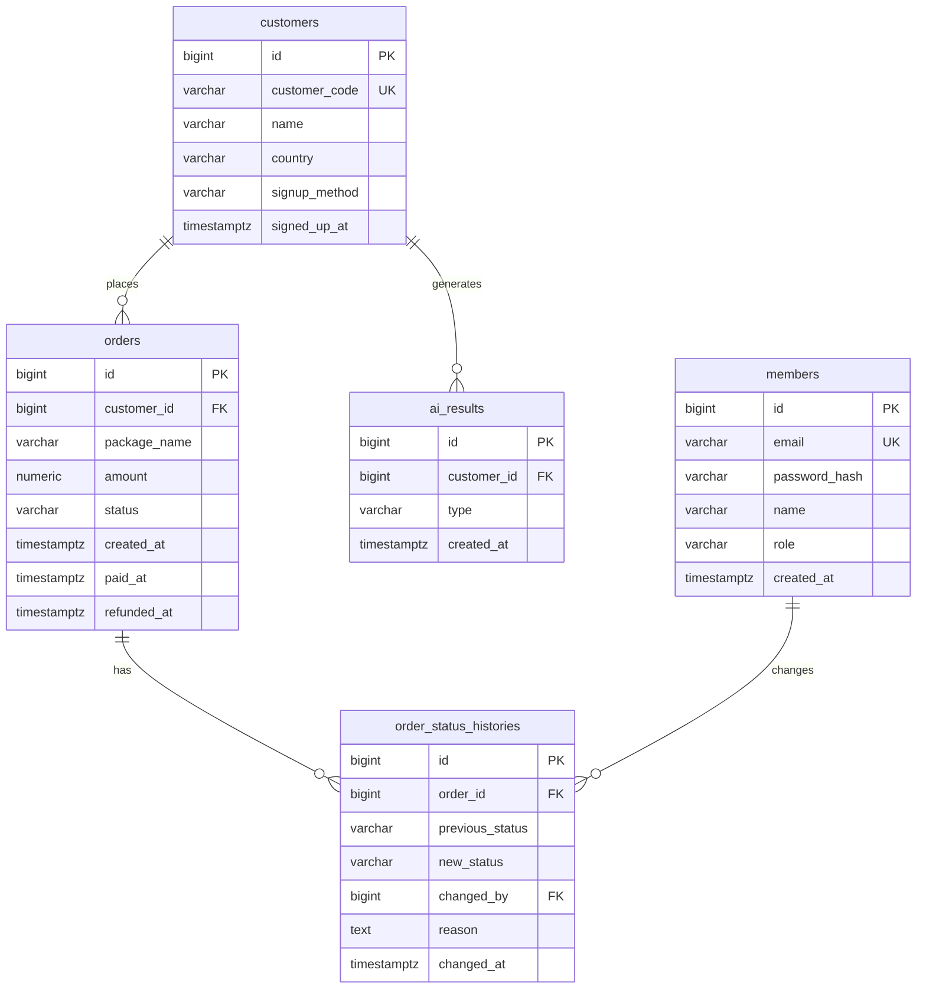

# ERD – Genie Vina

Chọn PostgreSQL 14+. API dùng camelCase theo đề, database dùng snake_case (`customerCode` ↔ `customer_code`). ERD dưới đây render được trên GitHub.

## Quyết định thiết kế

| Nội dung | Quy ước |
|---|---|
| Quan hệ | Mỗi bản ghi con thuộc đúng một bản ghi cha; cha có thể chưa có bản ghi con |
| Tiền | `NUMERIC(18,2)`, không dùng số thực; dữ liệu mẫu thống nhất VND. Đề chưa yêu cầu đa tiền tệ |
| Quốc gia | Mã hai chữ cái viết hoa, ví dụ VN, KR |
| Thời gian | `TIMESTAMPTZ`, thống kê ngày theo `Asia/Ho_Chi_Minh` |
| Mật khẩu | `password_hash` thay cho trường `password`; không lưu mật khẩu thô |
| Ngày tạo đơn | Bổ sung `created_at` để kiểm tra đơn không trước đăng ký và thanh toán không trước tạo đơn |
| Email thành viên | Unique không phân biệt hoa/thường |
| Xóa dữ liệu | FK `RESTRICT`: không xóa khách có đơn hoặc kết quả AI; không xóa đơn/thành viên đang được lịch sử tham chiếu |
| Kết quả AI | Một dòng là một QUOTE hoặc WEBSITE; không cần lưu nội dung hay chạy mô hình AI cho phạm vi đề |
| Hoàn tiền | Hoàn toàn bộ đơn; giữ `paid_at` khi chuyển `REFUNDED`. Chưa mô hình hóa hoàn tiền từng phần |

Trạng thái mới luôn bắt đầu `PENDING`. Chỉ cho phép `PENDING → PAID`, `PENDING → FAILED`, `PAID → REFUNDED`. `PAID` bắt buộc có `paid_at`; `REFUNDED` bắt buộc có cả `paid_at` và `refunded_at`. `PENDING`/`FAILED` không có hai mốc này. Thời gian phải theo thứ tự đăng ký ≤ tạo đơn ≤ thanh toán ≤ hoàn tiền.

Trigger tự ghi lịch sử khi **trạng thái thực sự thay đổi**. Tạo đơn PENDING không tạo lịch sử chuyển trạng thái. API đặt `app.member_id` và `app.change_reason` trong transaction (xem README); thiếu người đổi/lý do hoặc dùng VIEWER sẽ khiến UPDATE thất bại. `changed_at` là thời điểm thao tác; riêng seed chỉnh lại mốc này để mô phỏng lịch sử quá khứ. Schema không triển khai JWT hay toàn bộ phân quyền API.

## Quy ước thống kê đã triển khai

Các quy ước sau được áp dụng trong `app/metrics.py` để giải quyết chi tiết đề chưa nêu:

- `from`, `to` là ngày, bao gồm cả hai ngày. Truy vấn timestamp bằng khoảng nửa mở `[from 00:00, ngày sau to 00:00)` theo UTC+07. Từ chối `from > to`.
- Số ngày `D = to - from + 1`. Kỳ trước là `[from - D ngày, from - 1 ngày]`.
- Khách trả phí: distinct `customer_id` có đơn hiện ở trạng thái PAID và `paid_at` trong kỳ. Khách lần đầu có MIN(paid_at) trên **tất cả đơn hiện PAID trong toàn bộ lịch sử** nằm trong kỳ. Khách thanh toán lại = khách trả phí − khách lần đầu; hai nhóm không trùng nhau, kể cả khách mua nhiều lần trong kỳ đầu tiên.
- Theo định nghĩa đề, đơn đã REFUNDED không còn là đơn hợp lệ, kể cả khi xem lại kỳ thanh toán cũ. Vì vậy doanh thu/khách lần đầu của kỳ cũ có thể thay đổi sau hoàn tiền. Nếu muốn báo cáo lịch sử bất biến, cần thống nhất lại nghiệp vụ và khai thác lịch sử trạng thái.
- Đăng ký mới: đếm `signed_up_at` trong kỳ. Tăng trưởng = `(hiện tại − kỳ trước) / kỳ trước × 100`. Nếu kỳ trước = 0, trả `null` để biểu thị không xác định.
- Doanh thu = SUM(amount) của đơn hợp lệ trong kỳ; trung bình ngày = doanh thu / D, tính cả ngày doanh thu 0.
- Hoàn tiền: đếm đơn và SUM(amount) theo `refunded_at` trong kỳ; không lọc status PAID. Không tự trừ khoản hoàn khỏi doanh thu được định nghĩa trong đề.
- Doanh thu ngày: tạo đủ D ngày, LEFT JOIN doanh thu theo ngày địa phương, điền 0 nếu không có giao dịch.

## Dữ liệu giả

Script không dùng thư viện ngoài. Cùng tham số tạo cùng dữ liệu và SQL. Mặc định có 60 khách, 3 thành viên đủ vai trò, cả 4 trạng thái đơn và 2 loại kết quả AI. Các khách 1–6 là tình huống cố định:

| Khách | Tình huống |
|---|---|
| SYN-00001 | Có thanh toán trước kỳ và hai đơn PAID trong kỳ: kiểm tra mua lại, distinct khách |
| SYN-00002 | Thanh toán hợp lệ lần đầu trong kỳ |
| SYN-00003 | Đã thanh toán rồi hoàn tiền trong kỳ: chỉ tính vào hoàn tiền |
| SYN-00004 | Đơn FAILED |
| SYN-00005 | Đơn PENDING |
| SYN-00006 | Có kết quả AI, chưa mua gói |

Các khách còn lại có đăng ký ở kỳ hiện tại/kỳ trước và số đơn khác nhau. Ngày cuối kỳ và mỗi ngày thứ bảy tính từ đầu kỳ không có doanh thu; vẫn có dữ liệu AI tại đầu và cuối kỳ. Lịch sử được sinh qua chính các chuyển trạng thái hợp lệ, không chèn tay. Seed đặt lại sequence sau khi nạp ID để lần tạo dữ liệu tiếp theo không trùng khóa.

## Bảng kỹ thuật xác thực

Ngoài 5 bảng nghiệp vụ, `revoked_tokens(token_hash PK, expires_at)` lưu SHA-256 JWT đã logout. Không lưu token thô; bảng này không có FK đến nghiệp vụ. Mỗi request kiểm tra token chưa bị thu hồi và đọc vai trò hiện tại từ `members`. Database đã cài bản cũ cần chạy `database/migrations/001_revoked_tokens.sql`.
